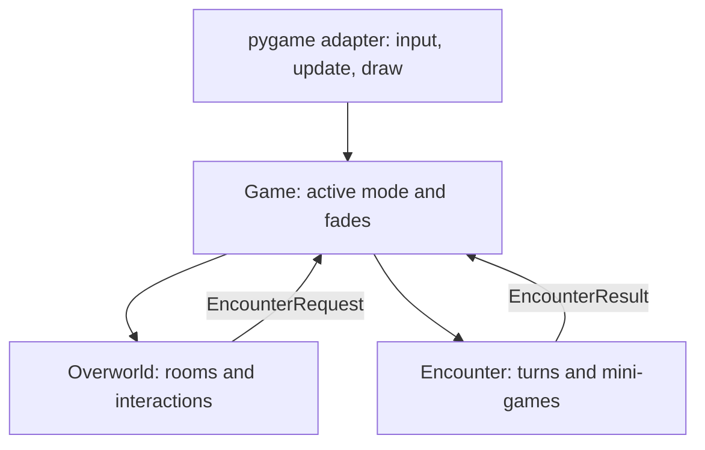
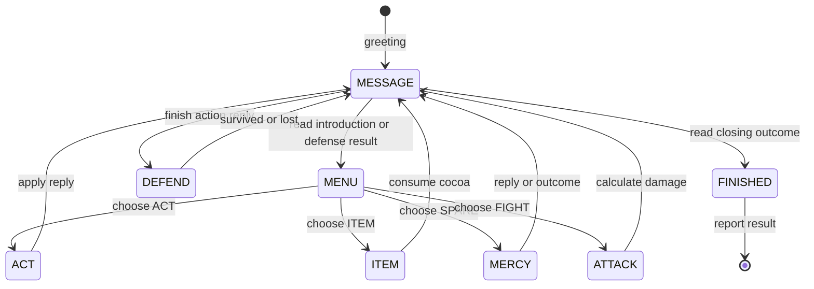

# Read the whole engine

The goal is to explain a change before making it: **what input arrives, what
state changes, and how the next frame shows it**. You can work through this guide
without completing any assignment. Use F2 to compare your predictions to the
running game's position, facing, flags and encounter phase.

## 1. A frame is a small experiment

Read `runtime.run`. One loop iteration does four things:

1. `read_input` receives pygame events and constructs `Controls`.
2. `Game.update(seconds=seconds, controls=controls)` changes the active model.
3. `View.draw(surface=surface, game=game)` draws that state.
4. The adapter plays queued sounds and presents the scaled picture.

`seconds` is elapsed time, usually about 1/60. A speed of 155 pixels/second
moves `155 * 0.1 = 15.5` pixels in a tenth of a second. A fixed movement per
frame would run faster on a faster machine. The adapter caps long desktop frame
stalls; the collision engine also splits large moves into small steps.

Only the adapter reads actual keyboard events. You can construct a Controls
record yourself in a test to reproduce an input without touching the keyboard.
`move_x` and `move_y` describe held movement. `confirm_pressed` is a one-frame
event. Holding Z keeps a key held but must not select a new menu choice every
frame. Look at `read_input` to find the place that makes that distinction.

## 2. Records, methods, and keyword arguments

A dataclass is a short way to define an object holding named values:

```python
player = Player(name="Courier", max_hp=20, hp=5)
healed = player.heal(amount=3)
```

`player.hp` is now 8 and `healed` is 3. `heal` is a method: a function attached
to the object whose values it changes. In its definition, `self` refers to that
particular player. You do not pass `self` when calling it.

Our constructors use keyword arguments so every value has a visible meaning.
A `*` in a function signature means the arguments after it must be named.
Python reports a misspelled argument at the call rather than letting an unknown
option hide inside a dictionary.

Keep two kinds of objects distinct:

- **Definitions:** rooms, people, writing, ACT choices and weapon factories.
- **Changing state:** position, current page, HP, selected action and timers.

For example, the same Dialogue definition can create two independent
Conversations. Reading one must not advance the other's page.

## 3. The system boundary



Read `contracts.py`, then `Game.update` and `Game.apply_request`. A request is
plain data: the encounter ID and the person who requested it. An encounter
result is plain data: an outcome and opponent name. Neither engine calls the
other. The coordinator is the one place that connects the two.

During a fade, only the transition clock advances. Once the screen is covered,
Game applies its stored request exactly once. This prevents the invitation's Z
press from also selecting FIGHT. A room door uses a RoomRequest for the same
reason. The world owns its destination and arrival marker; Game supplies the fade.

Start an encounter or defense directly and the world need never be constructed.
The result screen stays in that isolated mode until R or quit. Conversely,
opening the overworld does not import the encounter catalog. A deliberate
encounter request or Tab technique selection asks the coordinator to load it.

## 4. Trace a walking frame

Read `overworld/engine.py`, beginning with `World.update`, then follow `move`.

Suppose you hold Right for a frame lasting 0.02 seconds:

1. Controls contains `move_x=1`, `move_y=0`.
2. World asks the student's `movement_speed(controls=controls)` for a speed.
3. `move` remembers facing right, even if a wall prevents movement.
4. A normal speed of 155 gives a horizontal distance of 3.1 pixels.
5. `passable` checks the player's corners against the map's walls and water.
6. X and Y are tried separately, allowing a slide along a wall.
7. Actual motion advances the walk-animation clock.
8. `choose_player_view(facing=self.facing)` stores the student's selected view.
9. `WorldView.draw` draws that view at the new position.

On the next frame, no movement keys means a zero direction. Facing keeps its
previous value, so idle art stays pointed right. The render method never calls
the student function; drawing twice cannot run a rule twice.

Three coordinate systems appear here:

| System | Example | Where it belongs |
| --- | --- | --- |
| Tile coordinates | column 7, row 12 | Placement of map letters |
| Room pixels | the center of that tile | Walking and world collisions |
| Screen pixels | room position plus its centered display offset | Drawing only |

`tile_center` converts a tile to room pixels. A smaller map is centered by the
renderer, not by changing the collision coordinates. Window resizing scales the
finished logical frame without moving any model objects.

## 5. Trace one interaction and one remembered event

Read `World.interactable`, `interact`, and `update_triggers`.

A Z press finds the closest usable object. Its record type chooses a concrete
branch: Rest restores resources; Item sets its collection flag; Person/Sign
opens a Conversation. Their optional `on_interact` functions run first after
requirements pass. A Person may offer an encounter after its writing finishes.
A peaceful person has no encounter link and needs no opponent definition.

A trigger uses **entry**, not Z. On each frame, the world builds the set of
trigger tiles the player occupies. A trigger runs if present now but absent in
the previous set. Standing still is not another entry. Leaving removes its
membership; returning creates a new entry. This is why a healing effect does
not run sixty times a second. Trace those two sets on paper for five frames.

Session flags are ordinary strings in a set. A collectible can add `"bookmark"`;
a Door with `required_flag="bookmark"` can then open. For a more involved rule,
write a named function accepting `session` and pass it as `when=your_function`.
There is no expression language to learn.

Choice flags commit when selected. Dialogue completion flags commit only when
the final page is confirmed. Cancelling a reply cannot undo a choice already
made. See `Conversation.update` for the exact branches and return points.

## 6. Trace an entire encounter turn

Read `encounters/engine.py`: `update`, its four handlers, then `choose`.



`MESSAGE` remembers its destination in `after_message`; the destination depends
on why the message appeared. Revealing a page and advancing it are separate
presses. `Phase` is an enum: a named set of alternatives. Compare a phase to
`Phase.DEFEND` rather than inventing another string spelling.

For example, ACT → Listen does the following:

1. The menu selection identifies an Act record.
2. Its calm gain increases understanding up to the opponent's target.
3. Its reply opens as MESSAGE, with DEFEND as the destination.
4. Reading the reply enters DEFEND. The selector receives a TurnContext.
5. The selector returns a fresh pattern; Arena borrows the shared Player.
6. During each frame, Arena moves the soul, asks the pattern for hazards,
   advances warnings/projectiles/beams, then resolves hits and expiry.
7. Surviving opens a result message, then returns to MENU.
8. Enough understanding makes SPARE work on a later choice.

FIGHT instead creates a Strike. The strike reports accuracy from 0 to 1;
Encounter converts it to damage. Keeping timing separate from damage lets a
new weapon reuse the same encounter rules.

## 7. Follow a projectile and its timer

Read `Arena.update`, `move_soul`, `advance_bullets`, and `advance_beams`.
Then read one worked pattern in `encounters/patterns.py`.

A pattern chooses what to create. Arena chooses how hazards move, warn, collide,
and expire. Projectile velocity is pixels/second. During warmup it warns without
moving or hurting. When a frame straddles the end of warmup, only the remaining
part of that frame moves the bullet. A swept collision tests the whole motion
segment so a fast bullet cannot jump over the player between frames.

After a hit, a short invulnerability timer prevents many overlapping hazards
from removing all HP immediately. A successful shield block removes the bullet
before body damage is considered. These rules belong in Arena, so every pattern
benefits from a fix without copying it into all enemies.

Player HP has one owner: `Session.player`. `Encounter.player` and `Arena.player`
reference that same object. Arena's `hp` property forwards to it; there is no
second health number requiring a copy-back step. The world fountain and a new
custom healing mechanic affect the same object.

A new pattern instance owns fresh cooldowns. Returning an already-used instance
would carry an old timer into the next turn. Constructing `LanternPulse()` is
therefore an important operation, not just punctuation.

## 8. Find a place for your own rule

Ask which state must change and who owns that state. Read that owner's update
method and its caller. Find a similar existing rule, predict what would happen
if you changed it, then make the smallest experiment.

A new movement rule belongs near world movement. A damage rule belongs in
Arena. An action's effect belongs in the encounter action handling. A visual
change belongs in its system's renderer. A change of mode belongs in Game.
You may change any of these files; the student functions are starting points.

After guided missions, use [CHALLENGES.md](CHALLENGES.md) to practice locating,
implementing and connecting code without a preselected TODO. Explain the path
from input to state to picture in your own words before calling the feature done.
